# Как редактировать сайт: инструкция

Всё содержимое сайта меняется в админке, код трогать не нужно: тексты, кнопки, меню, изображения,
статьи, проекты, логотипы, поля формы, документы и SEO.

**Админка:** `https://<адрес сайта>/admin` (сейчас — https://procurement-site.imakanovr.workers.dev/admin)

---

## 1. Вход и обзор

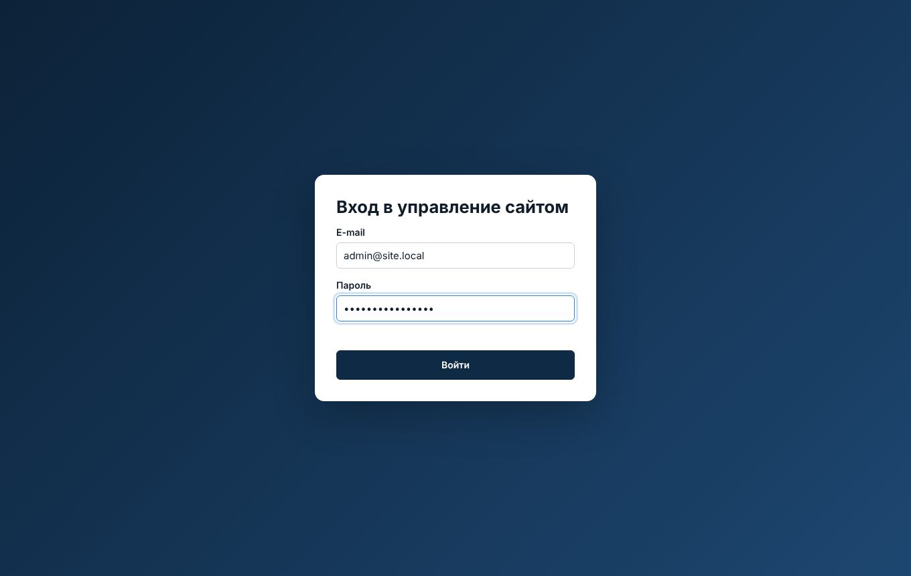

Войдите по e-mail и паролю. Пароль можно сменить в разделе **«Мой аккаунт»**.
После 10 неудачных попыток вход блокируется на 15 минут.

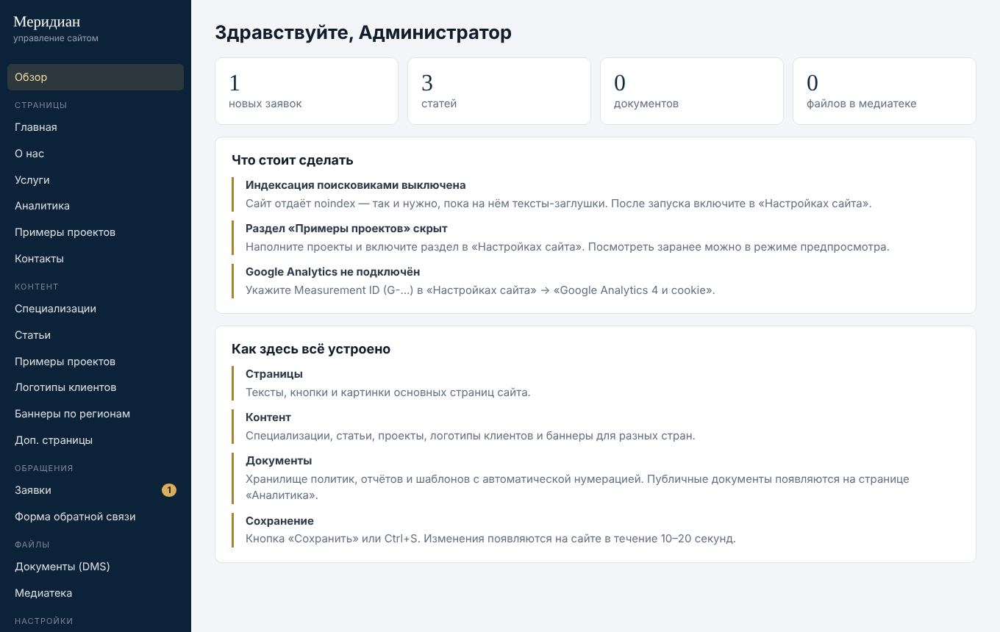

Слева находится меню разделов:

| Раздел | Что там |
|---|---|
| **Страницы** | Тексты и кнопки основных страниц: Главная, О нас, Услуги, Аналитика, Примеры проектов, Контакты |
| **Контент** | Специализации, статьи, проекты, логотипы клиентов, баннеры по регионам, дополнительные страницы (например, политика конфиденциальности) |
| **Обращения** | Заявки с сайта и настройка полей формы |
| **Файлы** | Документы (DMS) и медиатека изображений |
| **Настройки** | Название, контакты, меню, подвал, Google Analytics, cookie, SEO, пользователи |

На телефоне меню открывается кнопкой ☰.

## 2. Тексты и кнопки страниц

Откройте **Страницы → Главная** (или другую страницу). Поля сгруппированы по блокам в том порядке,
в каком блоки идут на сайте.

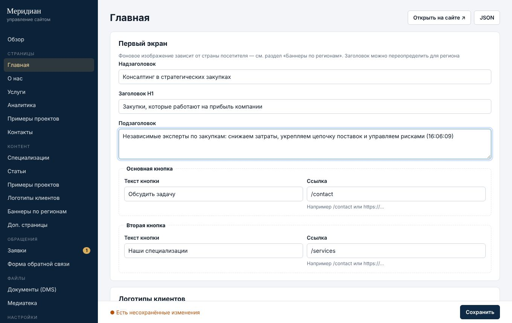

- Измените текст и нажмите **«Сохранить»** внизу экрана (или **Ctrl+S**). Пока изменения не
  сохранены, внизу горит оранжевая отметка «Есть несохранённые изменения».
- На сайте правка появится в течение **10–20 секунд**.
- У каждой кнопки два поля: **текст** и **ссылка**. Ссылка бывает внутренней (`/contact`) или внешней (`https://…`).
- Кнопка **«Открыть на сайте ↗»** открывает страницу в новой вкладке.
- Списки (цифры, этапы, сотрудники, вопросы) редактируются прямо в форме: **«+ Добавить»**,
  стрелки **↑ ↓** меняют порядок, **✕** удаляет элемент.

## 3. Изображения

У поля с картинкой три кнопки: **«Загрузить…»** (файл с компьютера), **«Из медиатеки»** (уже загруженный
файл) и **«Убрать»**. Под картинкой есть поле **alt**: короткое описание для поисковиков и людей
с программами экранного доступа.

- Фотографии можно загружать любые (JPG, PNG, WebP). Админка сама уменьшит их и сохранит в нескольких
  размерах, а сайт будет отдавать каждому посетителю подходящий. Логотипы лучше загружать в SVG
  или PNG на прозрачном фоне.
- Все файлы собраны в разделе **Файлы → Медиатека**. Там можно поправить alt или удалить картинку.

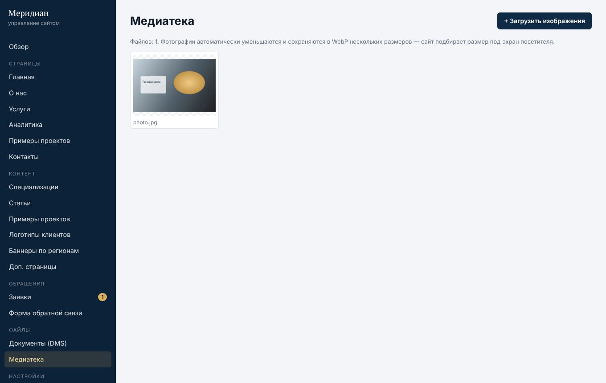

## 4. Специализации, статьи и черновики

**Контент → Специализации.** Здесь три страницы услуг: название, адрес страницы, иконка, описание,
состав услуги, результаты, этапы, вопросы и ответы, блок логотипов клиентов.

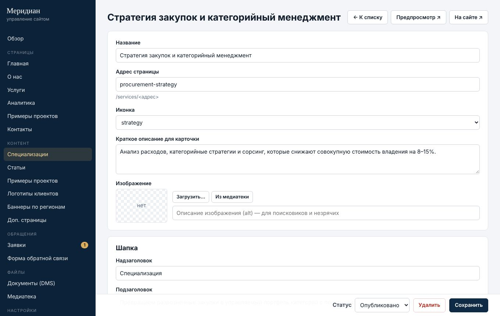

**Контент → Статьи** — материалы раздела «Аналитика». Текст статьи набирается в редакторе с кнопками
форматирования: **Ж** — жирный, **К** — курсив, **H2/H3** — подзаголовки, списки, цитата, ссылка,
картинка из медиатеки, таблица. Кнопка **«Предпросмотр»** показывает текст так, как он будет выглядеть.

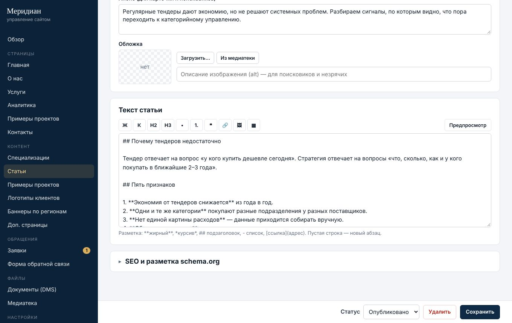

- **Статус «Черновик»** скрывает запись с сайта. Кнопка **«Предпросмотр ↗»** открывает страницу
  со всеми сохранёнными изменениями, но видна она только вам.
- **Адрес страницы** заполняется автоматически из заголовка (латиницей). Его можно задать вручную.
- Порядок специализаций, проектов и логотипов меняется стрелками ↑ ↓ в списке.
  Статьи сортируются по дате публикации.

## 5. Примеры проектов (пока скрыты)

**Контент → Примеры проектов**: заголовок, слоган, резюме (задача клиента), результат, ключевые цифры,
изображение. Пока раздел выключен, его не видят ни посетители, ни поисковики. Посмотреть страницу
можно через **«Предпросмотр»** или **Страницы → Примеры проектов → «Открыть на сайте»**.

Чтобы показать раздел: **Настройки сайта →** включить **«Показывать раздел «Примеры проектов»»** →
«Сохранить». Пункт «Проекты» сразу появится в меню.

## 6. Логотипы клиентов

**Контент → Логотипы клиентов**: название, логотип, ссылка на сайт клиента (необязательно).
Галочка **«Показывать на главной и на странице услуг»** выводит логотип в общих блоках. В поле
**«Показывать на страницах специализаций»** отметьте нужные специализации; если не отметить ни одной,
логотип будет на всех.

## 7. Баннер главной страницы по регионам

Фон первого экрана и подзаголовок меняются в зависимости от страны посетителя.

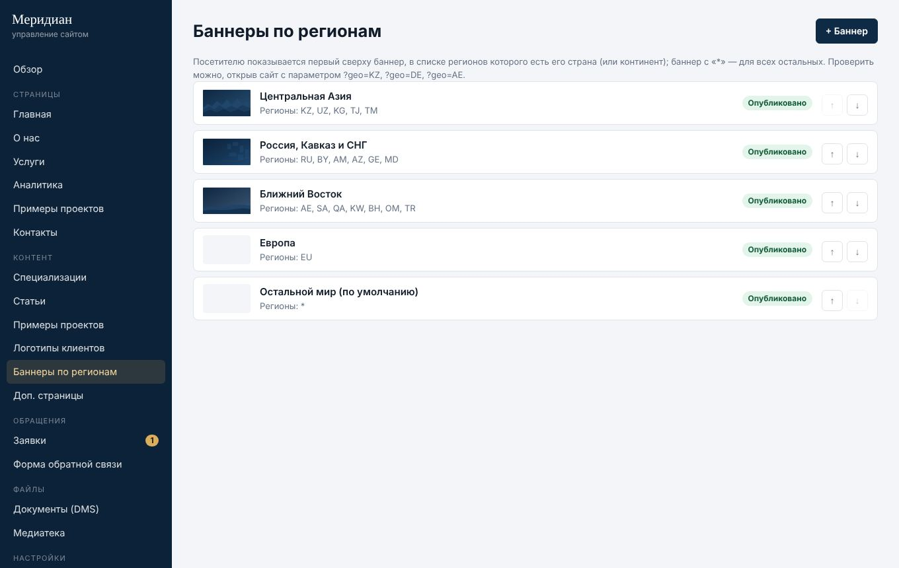

- У каждого баннера есть список **регионов**: коды стран через запятую (`KZ, UZ`) или континентов
  (`EU`, `AS`, `NA`, `SA`, `AF`, `OC`). Баннер со звёздочкой `*` показывается всем остальным.
- Срабатывает первый подходящий баннер **сверху вниз**, поэтому баннер `*` должен стоять последним.
- Заголовок и подзаголовок баннера необязательны: если их не заполнить, берутся тексты главной страницы.
- **Проверить**, как сайт выглядит из другой страны: добавьте к адресу `?geo=KZ`, `?geo=DE`, `?geo=AE`.

| Казахстан (`?geo=KZ`) | ОАЭ (`?geo=AE`) |
|---|---|
| 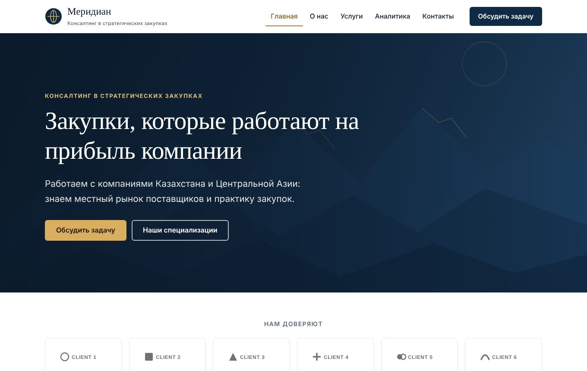 | 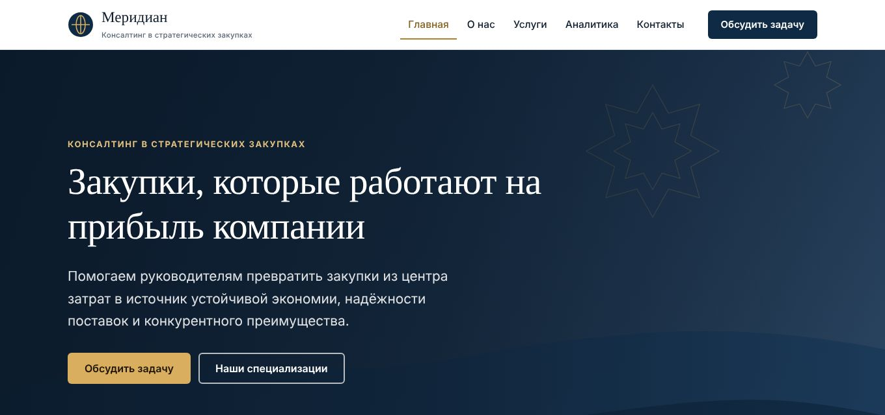 |

## 8. Форма обратной связи и заявки

**Обращения → Форма обратной связи** — поля формы на странице «Контакты»: подпись, тип (строка, e-mail,
телефон, текст, выпадающий список, галочка согласия), обязательность, подсказка, ширина. Здесь же
настраиваются текст кнопки и сообщения после отправки. В подписи галочки согласия можно поставить
ссылку: `[политикой конфиденциальности](/privacy)`.

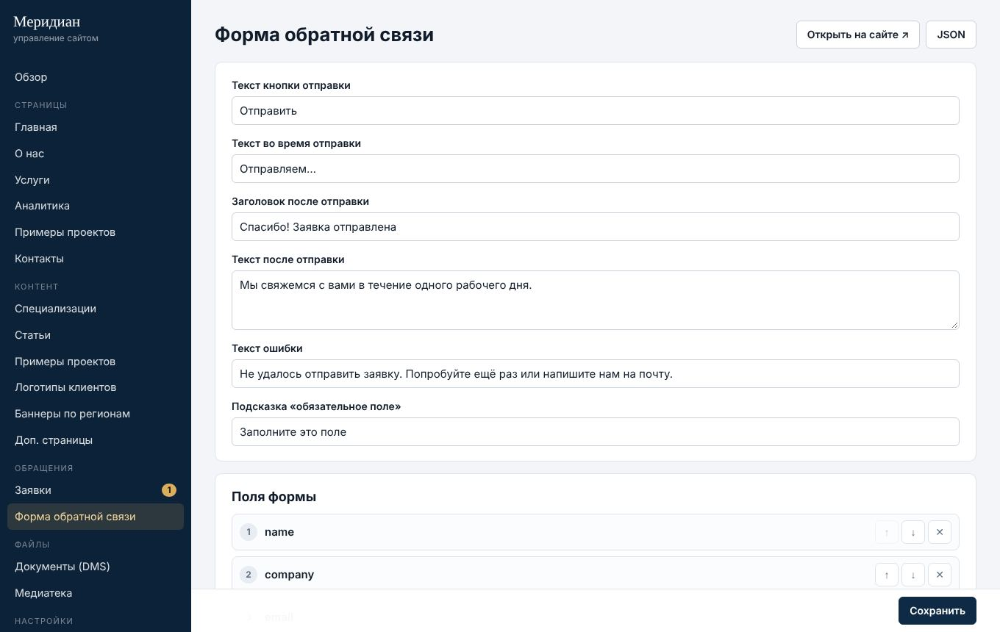

**Обращения → Заявки** — все обращения с сайта. Новые отмечены оранжевым, их количество видно в меню.
Заявку можно отметить «Обработана», «Спам» или удалить. Кнопка **«Выгрузить в Excel (CSV)»**
скачивает все заявки таблицей.

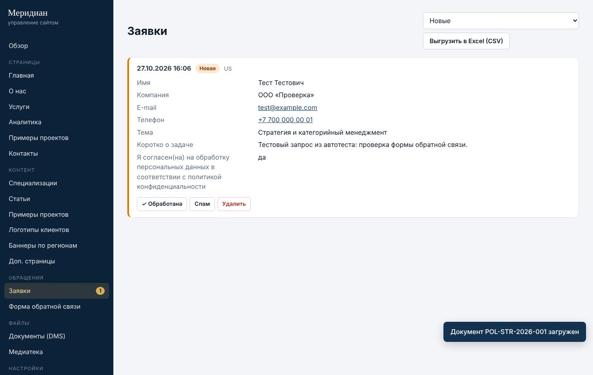

Уведомления о новых заявках на почту или в Telegram включаются в **Настройках сайта →
«Уведомления о заявках»**. Для этого администратор Cloudflare должен один раз задать секрет
(см. README).

## 9. Документы (DMS)

**Файлы → Документы (DMS)** — хранилище политик, регламентов, отчётов, шаблонов и договоров.

**Загрузка.** «+ Загрузить документ» → заполните тип, направление, дату, уровень доступа, название
(можно добавить владельца, клиента/проект, описание и теги) → выберите файл. Номер и имя файла
показываются ещё до загрузки:

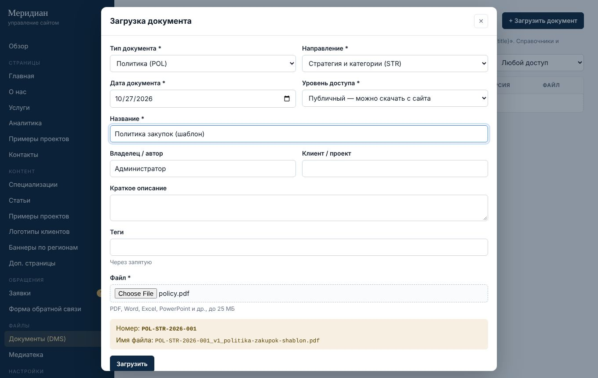

- **Номер** присваивается автоматически: `ТИП-НАПРАВЛЕНИЕ-ГОД-ПОРЯДКОВЫЙ` (например, `POL-STR-2026-001`).
  Нумерация ведётся отдельно для каждого сочетания типа, направления и года. Номера не повторяются,
  даже если документ удалить.
- **Имя файла** тоже формируется автоматически: `POL-STR-2026-001_v1_politika-zakupok.pdf`.
  Шаблоны номера и имени, а также справочники типов и направлений (коды и названия) настраиваются
  в **Настройках сайта → «Документы (DMS)»**.
- **Новая версия.** Откройте документ → «Загрузить новую версию». Номер остаётся прежним, версия растёт
  (v2, v3…). Все версии хранятся, любую можно скачать.
- **Уровень доступа.** *Публичный* — документ появляется на странице «Аналитика» в блоке
  «Материалы для скачивания». *Внутренний* и *Конфиденциальный* — скачать можно только из админки.
- Поиск и фильтры по типу, направлению и доступу — над таблицей.

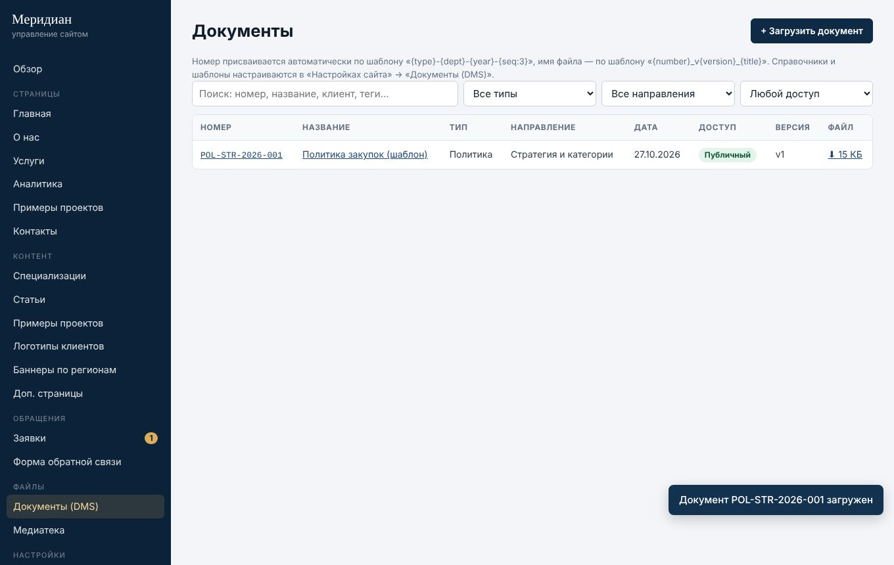

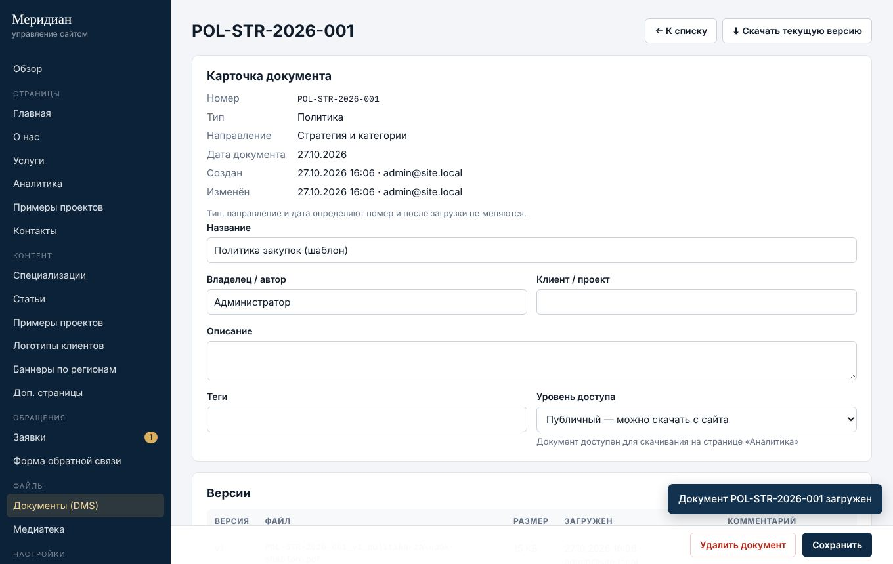

Удалить документ может только администратор. Редактор может загружать документы и править карточки.

## 10. Настройки сайта

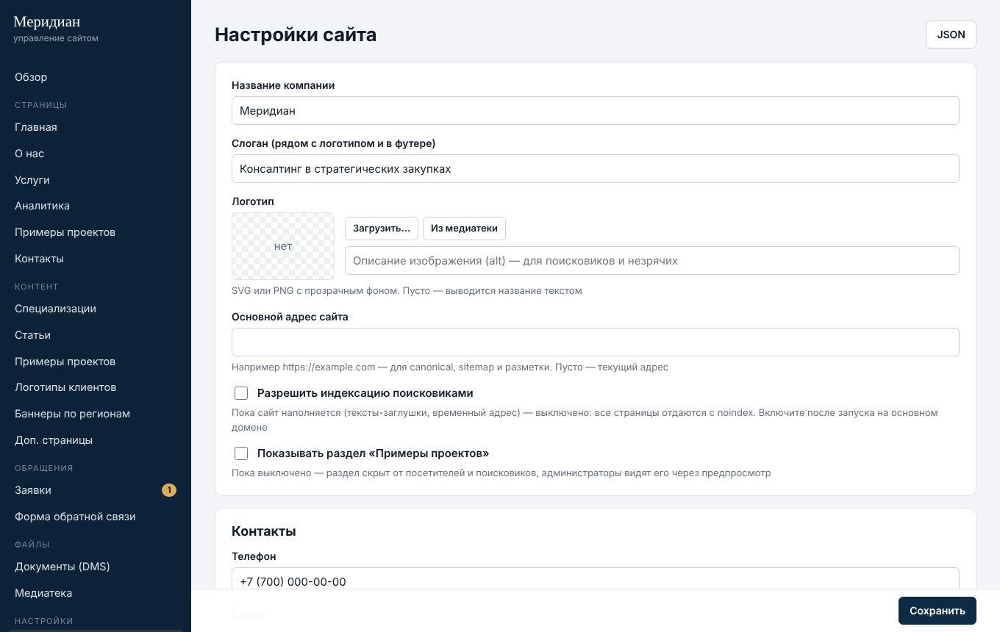

- **Название, слоган, логотип, контакты, меню, кнопка в шапке, подвал.**
- **Разрешить индексацию поисковиками.** Пока сайт наполняется, галочка выключена и поисковики страницы
  не индексируют. Включите её после замены текстов и подключения своего домена.
- **Основной адрес сайта**, например `https://ваш-домен.kz`. Нужен для canonical-ссылок, sitemap и разметки.
- **Google Analytics 4 и cookie.** Вставьте Measurement ID (`G-XXXXXXXXXX`) из Google Analytics → Admin →
  Data streams. Аналитика включается только у посетителей, нажавших «Принять» в уведомлении о cookie.
  Тексты уведомления и кнопок здесь же. Ссылка «Настройки cookie» в подвале снова открывает выбор.
- **SEO по умолчанию:** окончание заголовков, описание сайта, картинка для соцсетей, разметка организации.
- **Подписи интерфейса:** «Подробнее», «Скачать», текст страницы 404 и т. п.

## 11. SEO и разметка schema.org

У каждой страницы и записи внизу формы есть блок **«SEO и разметка schema.org»**:

- **Title** — заголовок во вкладке браузера и в поиске (до ~60 символов). Если оставить пустым, он
  сформируется из названия.
- **Meta description** — текст под ссылкой в поиске (до ~160 символов).
- **Картинка для соцсетей** — превью при отправке ссылки в мессенджерах (1200×630).
- **Дополнительная JSON-LD разметка** — свой код schema.org. Базовая разметка (организация, услуги,
  статьи, хлебные крошки, FAQ) уже добавляется автоматически. Есть кнопки «Форматировать», «Пример»
  и ссылка на валидатор.

**Схемы контента (JSON Schema).** В разделе **Настройки → «Схемы и резервная копия»** администратор
может поменять описание полей форм: подписи, подсказки, варианты выпадающих списков, порядок полей.

## 11а. Языки: русский, казахский, английский

Сайт доступен на трёх языках: `/` (русский), `/kk` (қазақша), `/en` (English). В шапке есть переключатель языка, в `<head>` страниц и в sitemap прописаны hreflang-ссылки для поисковиков.

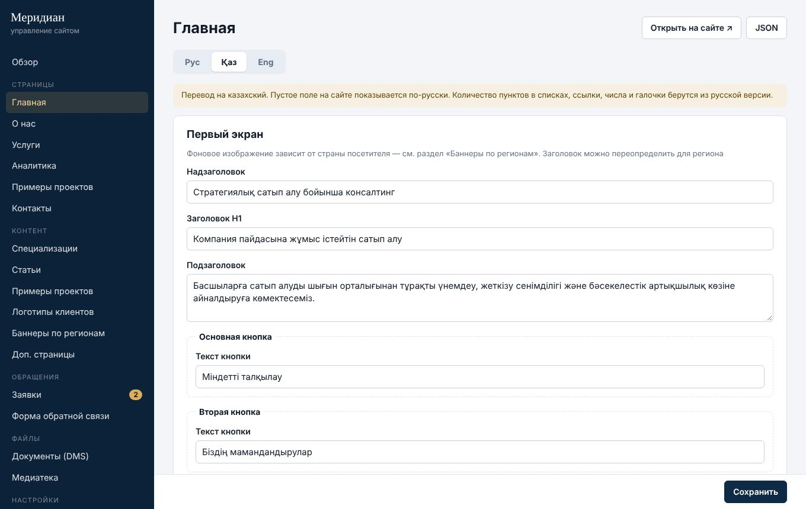

- Русская версия — основная. Над формой любой страницы и записи есть вкладки **Рус | Қаз | Eng**. Откройте нужный язык и заполните переводы.
- **Пустое поле на сайте показывается по-русски**, поэтому переводить можно постепенно.
- Количество пунктов в списках, ссылки, числа, галочки, картинки-заглушки и адреса страниц берутся из русской версии. Если вы добавили пункт в русскую версию, появится пустое поле для перевода.
- Тексты кнопок, меню, подвала, cookie-уведомления и подписи интерфейса переводятся в **Настройках сайта** (вкладка языка), поля формы — в «Форме обратной связи».
- Заявки с любого языка приходят в один список «Заявки».
- Стартовые переводы (казахский и английский) написаны заранее, их нужно вычитать носителю языка.

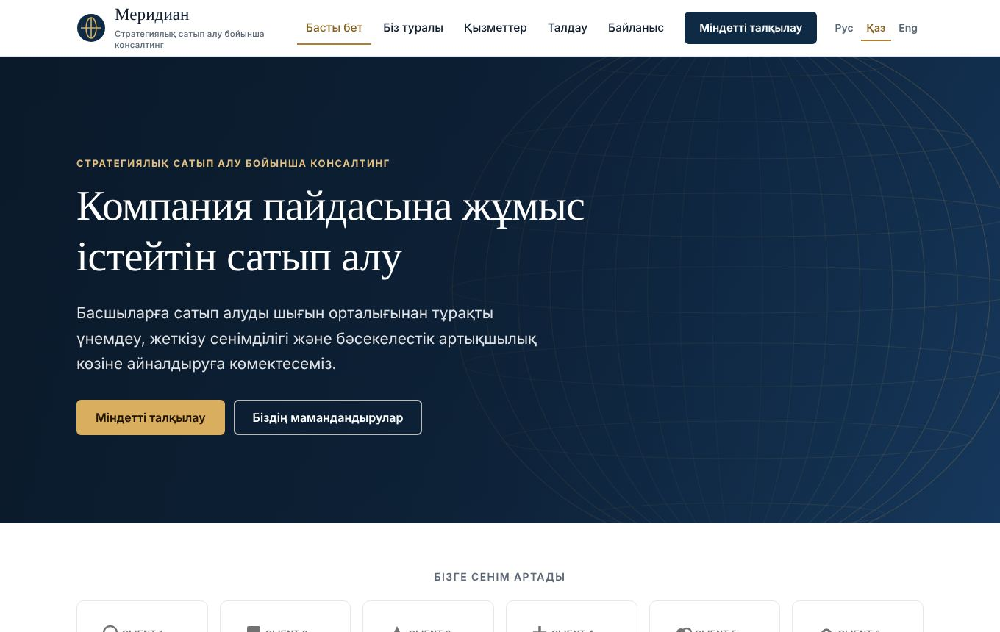

## 12. Пользователи

**Настройки → Пользователи** (только администратор): добавить сотрудника, сменить роль, сбросить пароль, удалить.

- **Администратор** может всё, включая настройки сайта, пользователей и удаление документов.
- **Редактор** работает с текстами, статьями, медиатекой, документами и заявками.

## 13. Резервная копия

**Настройки → «Схемы и резервная копия» → «Скачать резервную копию контента (JSON)»** — тексты, записи,
метаданные документов и заявки. Делайте копию раз в месяц и перед крупными изменениями.
Исходные файлы документов храните у себя: в эту копию они не входят.

## Частые вопросы

**Сохранил, но на сайте старый текст.** Подождите 10–20 секунд и обновите страницу.

**Как поменять пункт меню?** Настройки сайта → «Главное меню». Пункт `/cases` показывается, только когда
включён раздел проектов.

**Как добавить страницу (например, «Условия использования»)?** Контент → Доп. страницы → «+ Страница».
Она откроется по адресу `/<адрес>`. Галочка «Ссылка в подвале» добавит её в подвал.

**Сайт на телефоне.** Сайт и админка адаптированы под телефоны и планшеты; править тексты можно и с телефона.

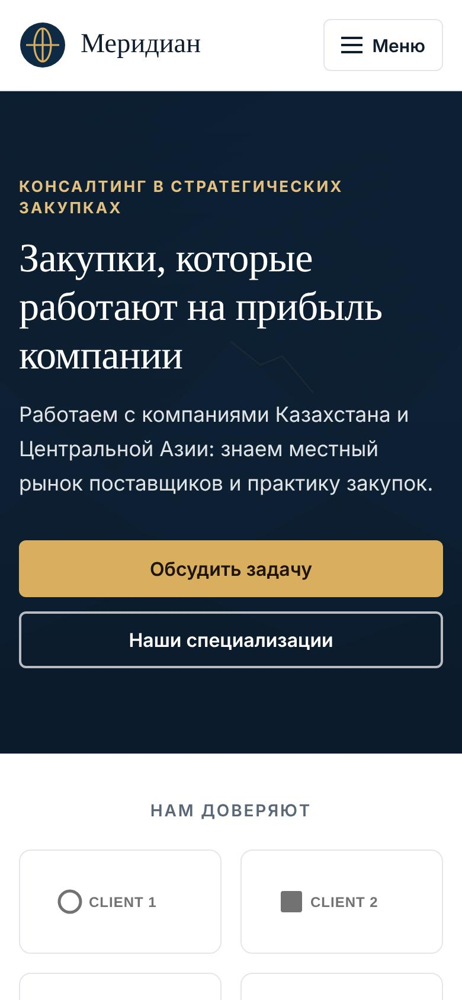 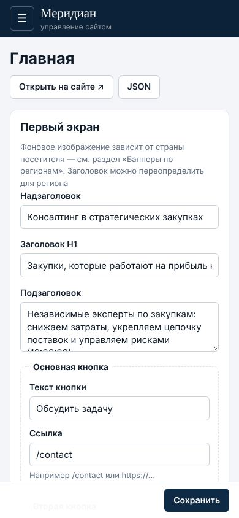
